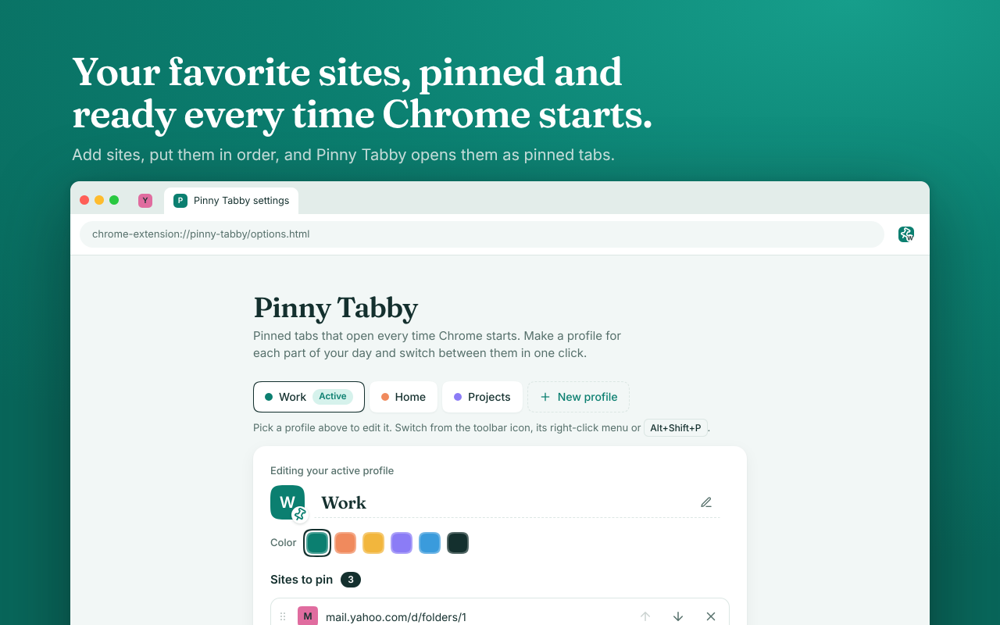
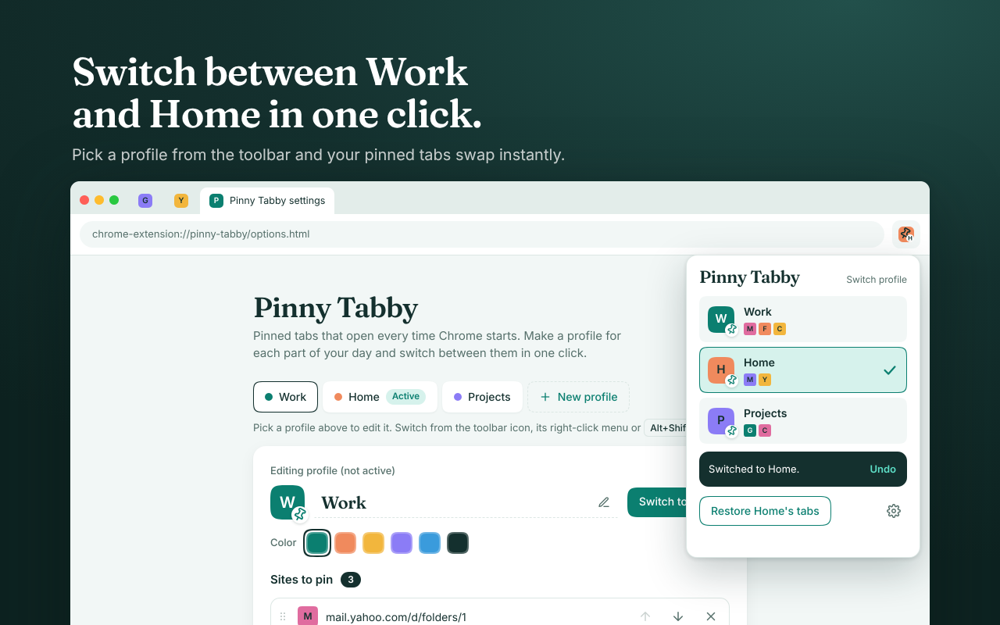

# Pinny Tabby

A Chrome extension that opens your favorite sites as pinned tabs every time Chrome starts, with profiles you can switch between in one click.

**[Add Pinny Tabby to Chrome](https://chromewebstore.google.com/detail/pinny-tabby/nmgifohnngmmelbmcdfpgojgkifcnbhc)**

## Features

- **Pinned tabs on startup.** Pick the sites you want and they open as pinned tabs whenever Chrome starts.
- **Profiles.** Make up to five, like Work, Home or a side project, each with its own sites and color.
- **One-click switching.** From the toolbar icon, its right-click menu, or Alt+Shift+P. Changed your mind? Undo brings your previous tabs back.
- **No duplicates.** Sites that are already open aren't opened again.
- **Use my current pinned tabs.** Save what you have pinned as a profile in one click.
- **Base URLs (optional).** Save `mail.google.com/mail/u/0/#inbox` as just `mail.google.com`.
- **Private by design.** No servers, accounts, analytics or ads. Nothing leaves your browser.

## Install

**Chrome Web Store (recommended):** [Add Pinny Tabby to Chrome](https://chromewebstore.google.com/detail/pinny-tabby/nmgifohnngmmelbmcdfpgojgkifcnbhc). Updates arrive automatically.

**From this repo (for developers):**

1. Download this repo (**Code → Download ZIP**) and unzip it.
2. Go to `chrome://extensions` and turn on **Developer mode**.
3. Click **Load unpacked** and choose the `extension` folder.

## Privacy

Pinny Tabby keeps your profiles in your own Chrome storage and never sends anything to anyone. Read the full [privacy policy](https://itsmikemike.github.io/pinny-tabby/privacy.html).

## Support

Found a bug or have an idea? [Open an issue](https://github.com/itsmikemike/pinny-tabby/issues).

## License

Pinny Tabby is released under the [MIT License](LICENSE). It includes icons from [Lucide](https://lucide.dev) (ISC) and the fonts Fraunces and Inter (SIL Open Font License); see [`extension/LICENSES.txt`](extension/LICENSES.txt).
